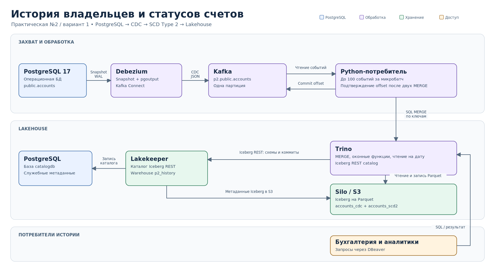
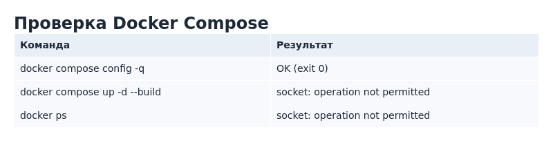
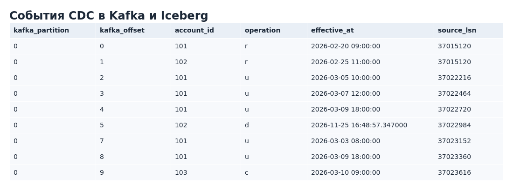
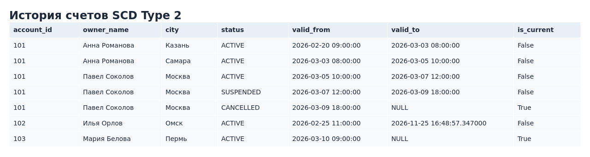
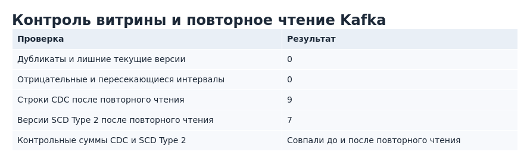

# Отчёт по практической №2

## 1. Вариант и задача

| Поле | Значение |
|---|---|
| ФИО (как в VK Education) | Иордан Дмитрий Сергеевич |
| Тема | Вариант 1. История в справочнике (CDC → SCD → Lakehouse) |
| Состав решения | PostgreSQL → Debezium / Kafka Connect → Kafka → Python-потребитель → Trino → Iceberg. Lakekeeper ведёт каталог, S3-совместимое хранилище содержит файлы таблиц. |
| Данные, объём | Синтетический справочник счетов. Две строки в начальном снимке и семь последующих изменений строк. Для счёта хранятся идентификатор, владелец, город, статус и момент вступления изменения в силу. |

Задача бухгалтерии — узнать владельца счёта на заданную дату. Аналитику нужно увидеть, в каком статусе счёт был перед отменой. События поступают из операционной базы, а бизнес-запросы выполняются на Iceberg через Trino.

## 2. Источники и способы сбора

| Источник | Тип | Способ сбора |
|---|---|---|
| Начальное состояние `operations.public.accounts` | Batch, согласованный снимок | Debezium с `snapshot.mode=initial` один раз считывает начальное состояние. Строки приходят как события `r`. История начинается с состояний, известных на старте. |
| Изменения `operations.public.accounts` | CDC, поток | PostgreSQL публикует изменения таблицы через `p2_accounts`. Debezium читает логический WAL через `pgoutput` и слот `p2_accounts_slot`, передаёт изменения в Kafka как `c`, `u`, `d`. |
| `p2.public.accounts` | Поток, транспорт CDC | Python-потребитель читает JSON из Kafka пачками, использует ключ `account_id` и хранит первое положение уникального события в топике. |

Разовый снимок требует чтения таблицы и может дать нагрузку при большом объёме. Дальше изменения берутся из WAL. Фильтрация ограничена одной таблицей, а аналитические `SELECT` выполняются в Trino. Под публикацию заведена отдельная роль PostgreSQL с правами репликации и чтения этой таблицы. `REPLICA IDENTITY FULL` даёт полное предыдущее состояние в событии, включая удаление, ценой большего объёма WAL.

## 3. Архитектура (draw.io безальтернативно)



Редактируемый исходник находится в [architecture.drawio](architecture.drawio). Схема показывает отдельно операционную базу `operations` и служебную базу `catalogdb`, которые на стенде работают в одном экземпляре PostgreSQL. Kafka хранит события и позиции групп. Lakekeeper согласует операции над каталогом Iceberg. Trino вычисляет версии и читает данные через тот же каталог. В Compose роль S3-хранилища выполняет Silo.

## 4. Docker — что поднялось (честно)

| Блок | Статус |
|---|---|
| Docker Compose | Конфигурация прошла `docker compose config -q`. Запуск контейнеров заблокирован на обращении к сокету Docker Engine. |
| PostgreSQL 17.12, Kafka 3.9.1 | Запущены отдельными процессами на Linux в проверочном прогоне. |
| Kafka Connect / Debezium 3.2.1.Final | Задача коннектора перешла в RUNNING и сформировала события снимка и WAL в Kafka. |
| Lakekeeper 0.15.0, Trino 476 | Запущены отдельными процессами. Lakekeeper создал warehouse, Trino создал две таблицы Iceberg. |
| Silo | Включён в Compose. Запуск бинарника Silo в проверочной среде завершился ошибкой доступа к netlink при определении адресов хоста. Для интеграционной проверки использован реальный S3-совместимый RustFS 1.0.6. |
| Python-потребитель | Запущен отдельным процессом. Сохранил CDC и материализовал SCD Type 2. В Compose описан сервисом `worker`. |
| DBeaver | Клиент для ручной проверки запросов на Windows. Автоматическая проверка отправила тот же SQL в Trino через Python-клиент. |

Фактический вывод проверки Docker, сокращён до значимых строк. Полный вывод сохранён в [docker.txt](screenshots/docker.txt).



```text
$ docker compose config -q
OK (exit 0)

$ docker compose up -d --build
... dial unix /var/run/docker.sock: socket: operation not permitted

$ docker ps
... dial unix /var/run/docker.sock: socket: operation not permitted
```

### Воспроизведение на Windows

В PowerShell из папки с `docker-compose.yml`, при запущенном Docker Desktop с Linux-контейнерами:

```powershell
docker compose config -q
docker compose up -d --build
docker compose ps -a
docker ps
docker compose logs setup worker
docker compose run --rm demo
```

`migrate` и `setup` завершаются кодом 0 после подготовки стенда. `demo` рассчитан на свежие данные и сначала ждёт две строки снимка. Для отдельного чистого прогона подходит новое имя проекта, например `docker compose -p p2-cdc-check up -d --build`, если порты свободны. Для повторного чтения Kafka остановить основной процесс записи, запустить проверку и снова поднять процесс записи:

```powershell
docker compose stop worker
docker compose run --rm --no-deps worker replay
docker compose start worker
```

В DBeaver выбрать драйвер Trino, адрес `localhost`, порт `9999`, каталог `iceberg`, схему `history`, имя пользователя `p2_analytics` и выполнить [контрольные запросы](sql/04_checks.sql). В сборке используется отдельный учебный проект Docker. Подключения, опубликованные Compose, привязаны к loopback.

## 5. Описание

| Шаг | Для чего | Результат |
|---|---|---|
| 1. Начальный снимок и логическое декодирование WAL | Получить начальное состояние и подтверждённые изменения строк | Debezium отправляет ключ, `op`, состояния строки и метаданные источника. |
| 2. Доставка через Kafka | Развязать сбор и запись в Lakehouse, дать возможность повторного чтения | Для справочника используется отдельный топик. В одной партиции порядок доставки задаёт offset. |
| 3. Первый `MERGE` | Сохранить исходные события и пережить повторную доставку | `accounts_cdc` хранит JSON и извлечённые поля. Идентификатор live-события складывается из LSN, ID транзакции и порядкового номера внутри неё. Для начального снимка используется ключ строки. |
| 4. Второй `MERGE` | Построить SCD Type 2 | Для ключей из пачки пересчитываются интервалы по всем их CDC-событиям. Iceberg получает новые версии и изменённые границы существующих. |
| 5. Подтвердить offset | Обеспечить восстановление после неполного прогона | Offset подтверждается после обоих `MERGE`. Если процесс остановился между операциями, повтор использует те же идентификаторы и доводит витрину до нужного состояния. |
| 6. Выполнить запросы в Trino | Ответить на вопросы бухгалтерии и аналитиков | Для даты выбирается интервал, которому принадлежит момент запроса. Полный журнал CDC доступен для сверки. |

### Почему SCD Type 2 и микробатчи

| Подход | Когда подходит | Выбор для варианта |
|---|---|---|
| SCD Type 1 | Исправление опечатки или ведение только текущего справочника | Перезапись потеряла бы прежнего владельца и статус. |
| SCD Type 2 | Отчёты на дату и аудит изменений по интервалам | У версии есть `valid_from`, `valid_to` и `is_current`. Это достаточно для двух контрольных вопросов. |
| SCD Type 6 | История и частые запросы текущего значения прямо из исторической строки | Дополнительные текущие атрибуты увеличили бы объём обновлений. Текущее состояние в этой работе выбирается условием `is_current`. |

Потребитель собирает до 100 сообщений за вызов `poll` с ожиданием до 1,2 секунды при отсутствии готовых данных. Группировка ограничивает число отдельных коммитов Iceberg и переписываемых файлов. У непрерывной обработки по одному событию ниже ожидание в очереди, но каждое событие запускает операции записи. Для небольшого стенда выбран Python. Spark Structured Streaming с `foreachBatch` подошёл бы при увеличении объёма и появлении потребности в распределённой обработке. Время ожидания в `poll` не задаёт верхнюю границу полной задержки: на неё также влияют CDC, Kafka, длительность SQL и коммиты Iceberg.

### Как строятся интервалы

Для `r/c/u` бизнес-время берётся из `effective_at`, для `d` берётся `source.ts_ms`. Все моменты трактуются как UTC. Внутри одного ключа при одинаковом времени сравниваются offsets. Повтор соседнего состояния в тот же момент остаётся в сыром журнале и не создаёт ещё один период. При разных состояниях в один момент интервалы промежуточных состояний могут иметь нулевую длину, а запрос по условию `[valid_from, valid_to)` их пропускает. `LEAD` вычисляет конец версии до исключения операций `d`, поэтому удаление закрывает последнюю версию. Kafka tombstone с пустым сообщением используется транспортом, содержательное удаление передаёт `op = 'd'`.

В демонстрации исправление на 3 марта приходит после отмены на 9 марта. История пересчитывается по времени действия, поэтому новый интервал встаёт между состояниями от 20 февраля и 5 марта. Второй `UPDATE` в той же исходной транзакции восстанавливает текущее операционное состояние и оставляет в CDC самостоятельное событие. Запрос на дату включает нижнюю границу и исключает верхнюю.

### SQL и проверка

Исходная таблица и права заданы в [postgres/init.sql](postgres/init.sql), DDL Iceberg — в [01_tables.sql](sql/01_tables.sql), материализация — в [02_scd2.sql](sql/02_scd2.sql), а демонстрационные `UPDATE`, `DELETE` и `INSERT` — в [03_changes.sql](sql/03_changes.sql).

**Владелец счёта 101 на 1 марта**

```sql
SELECT account_id, owner_name, city, status
FROM iceberg.history.accounts_scd2
WHERE account_id = 101
  AND valid_from <= TIMESTAMP '2026-03-01 00:00:00'
  AND (valid_to > TIMESTAMP '2026-03-01 00:00:00' OR valid_to IS NULL);
```

**Статус непосредственно перед отменой**

```sql
SELECT account_id, owner_name, status, valid_to
FROM iceberg.history.accounts_scd2
WHERE account_id = 101
  AND valid_from < TIMESTAMP '2026-03-09 18:00:00'
  AND valid_to = TIMESTAMP '2026-03-09 18:00:00';
```

### Фактические результаты

Запросы выполнены в Trino на данных, которые Debezium получил из PostgreSQL через WAL. Ниже приведены таблицы, отрисованные из [фактического вывода Trino](screenshots/trino.txt).

| Проверка | Получено |
|---|---|
| Журнал CDC | 9 событий. Два `r`, пять `u`, одно `d` и одно `c`. Пустое сообщение на offset 6 относится к удалению на offset 5. |
| История SCD Type 2 | 7 версий. Для счёта 101 пять версий и одна текущая. Для удалённого счёта 102 одна закрытая версия. Для нового счёта 103 одна текущая версия. |
| Владелец счёта 101 на 1 марта 2026, UTC | Анна Романова, Казань, `ACTIVE`. |
| Счёт 101 перед отменой | Павел Соколов, `SUSPENDED`, окончание интервала 9 марта в 18:00 UTC. |
| Позднее изменение | На offset 7 пришло состояние «Анна Романова, Самара» с датой 3 марта. В витрине оно действует с 3 марта, 08:00 до 5 марта, 10:00 UTC. |
| Проверки целостности | 0 нарушений уникальности и текущих версий. 0 отрицательных или пересекающихся интервалов. |





При повторном чтении Kafka обработаны offsets от 0 до 9. Количество строк осталось 9 и 7, контрольные суммы содержимого обеих таблиц совпали до и после повторной обработки. Группа основного потребителя сохранила следующий offset 10.



Подробности сохранены в [выводе потребителя](screenshots/worker.txt), [логе повторного чтения](screenshots/replay.txt) и [проверке компонентов и файлов Iceberg](screenshots/evidence.txt). Таблица системных метаданных Iceberg `$files` вернула пути к Parquet в бакете `p2-history`.


## 6. Выводы

Интервалы SCD Type 2 позволяют ответить на вопросы о счёте даже после смены владельца, позднего исправления и удаления. Сырой журнал и витрина нужны для разных задач: журнал показывает порядок получения событий, витрина показывает порядок действия бизнес-состояний.

Для учебного объёма удобно пересчитывать историю только затронутых ключей. В эксплуатации важно следить за отставанием слота PostgreSQL и ростом WAL, лагом Kafka, сроком хранения событий и количеством мелких файлов Iceberg. В этой сборке у Kafka один брокер, у consumer одна активная копия, а две записи в Iceberg выполняются последовательно. Между коммитами сырой журнал может ненадолго опережать витрину. Повтор безопасен при сохранении постоянных томов и идентичности источника. Снимок на чистом источнике с другим набором данных требует отдельного журнала или нового пространства идентификаторов.

### Мой любимый десерт

Торт «Наполеон».

### Материалы

- [Условия, описание варианта и форма отчёта](https://github.com/m1705161/p2)
- [Debezium PostgreSQL Connector](https://debezium.io/documentation/reference/stable/connectors/postgresql.html)
- [Каталог Iceberg REST в Trino](https://trino.io/docs/current/object-storage/metastores.html)
- [Пример Lakekeeper с Silo и Trino](https://github.com/lakekeeper/lakekeeper/tree/main/examples/minimal)
